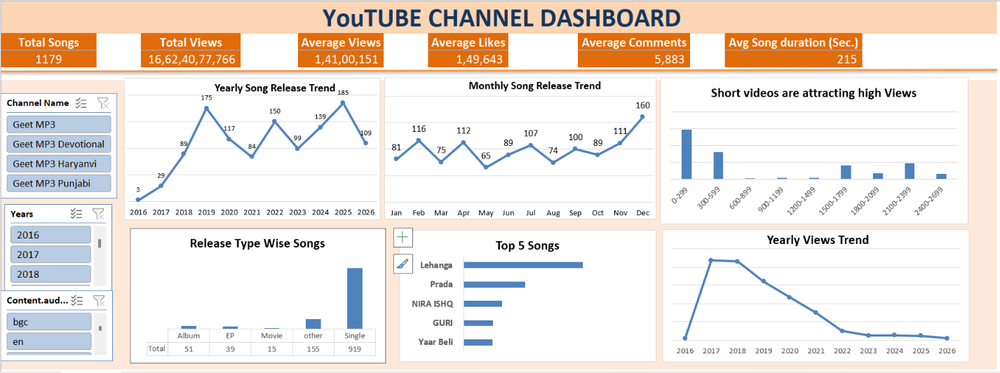

# YouTube-Channel-Analysis-Dashboard
Dashboard translates raw API data into visual insights designed for content strategists and creators. The getmp3 youtube channel data is extracted. The dashboard visualizes and Compares Performance data across key metrics - total songs, total views,avg video duration,time series analysis.

## WorkFlow

### Step1: Get YouTube channel data
i sent request to api key and fetched all data as dataframe or exported as excel file.

### Step2: Data Processing
i cleaned all data, removed duplicates and extracted specific columns data from description column.

### Step3: Dashboard Design
All sheets data is converted into a master sheet and created a attractive dashboard in excel using pivot tables.

---
##  Dashboard Overview

This dashboard serves as a central hub to track, compare, and analyze key metrics across four selected YouTube channels.




---
##  Built With

*   **Data Source:** YouTube Data API v3 (fetching channel snippets, statistics, and video details)
*   **Data Processing:** Microsoft Excel (Power Query)
*   **Visualization:** Excel Dashboards (Dynamic Charts, Pivot Tables, and Slicers)

---
## Features

*   **Multi-Channel Selector:** Filter the entire dashboard by a single channel or view a combined comparative analysis.
*   **Dynamic Pivot Charts:** Visual representations of watch trends, engagement spikes, and upload frequencies.
*   **KPI Cards:** High-level summary cards displaying real-time metrics for quick health checks.
*   **Automated Data Refresh:** Cleaned data structures built to update easily when new API data is dumped into the source sheets.

---
## 📁 Repository Structure

```text
├── YT-analysis-project.ipynb   # python file
│  
├── geetmp3_songs.xlsx   # The final interactive Excel dashboard
│
├── Screenshots/
│   └── dashboard.png       # Preview image of the dashboard
└── README.md                       # Project documentation
```

---
##  How to Use the Dashboard

1.  **Clone the Repository:**
    ```bash
    git clone https://github.com
    ```
2.  **Open the File:** Navigate to open `geetmp3_songs.xlsx` using Microsoft Excel.
3.  **Interact:** Use the timeline and slicer buttons on the left of the sheet to filter data by channel,year.

---

## Contributing

Your suggestion requests are welcome! Feel free to check the repository if you want to contribute to the automation scripts or dashboard layout.
